# Lab64

**Assemble, test, emulate and analyze C64 programs** — a toolchain for the Commodore 64 that runs entirely in Docker containers.

Copyright © 2026 - Simone Caporale. Released under the MIT License ([LICENSE](LICENSE)); the third-party programs it uses keep their
own licenses ([THIRD-PARTY.md](THIRD-PARTY.md)).

Lab64 is **generic**: Docker images with the assembler, the disk tools, VICE and a browser emulator, a test-friendly VICE setup,
an automatic memory map, instruction manuals and a live viewer with a control center. **It knows nothing about any game.** A project
uses it from its own folder through the `lab64` command and configures it with a `lab64.env` file in its root.

## At a glance

- **Everything runs in containers.** Host requirements: sh, Docker with BuildKit and Compose v2, git, curl. Linux, or Windows through WSL2 (tried by the owner, 17/11).
- **External programs** (64tass, cc65, cc1541, ZX0, VICE, sidplayfp, ...) are compiled from source inside the images.
- **The Commodore ROMs are not included**: copy them into `roms/vice-roms/` before building the images ([roms/roms.md](roms/roms.md)).
  The images contain them, so they are never published.

```
<lab64 folder>/cli/lab64 install        # once: puts `lab64` in the PATH
mkdir hello && cd hello && lab64 init   # a project that builds as is
lab64 build && lab64 test && lab64 manual && lab64 map
lab64 view                              # control center on http://localhost:6080
```

## Screenshots

What any project gets from the viewer, taken on a project made by `lab64 init` ([the viewer](docs/viewer.md)).

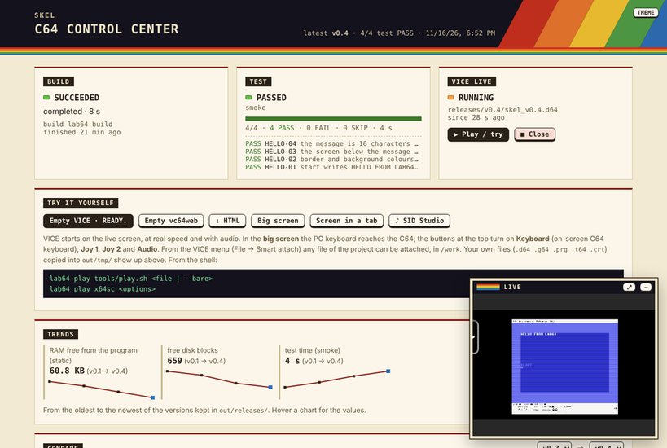

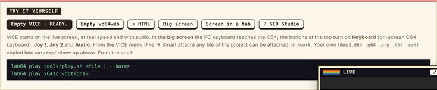

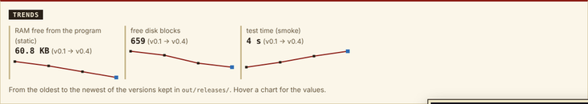

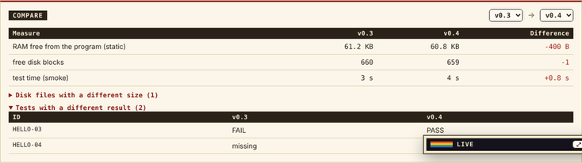

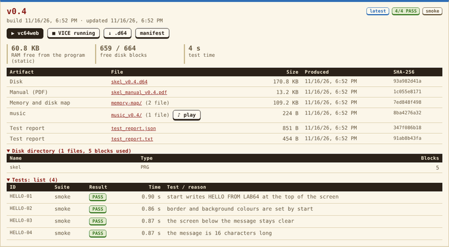

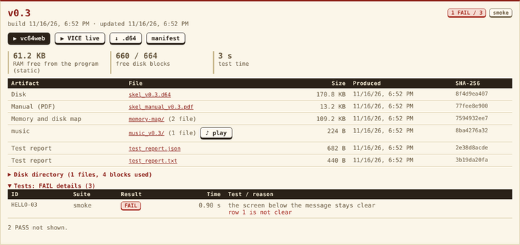

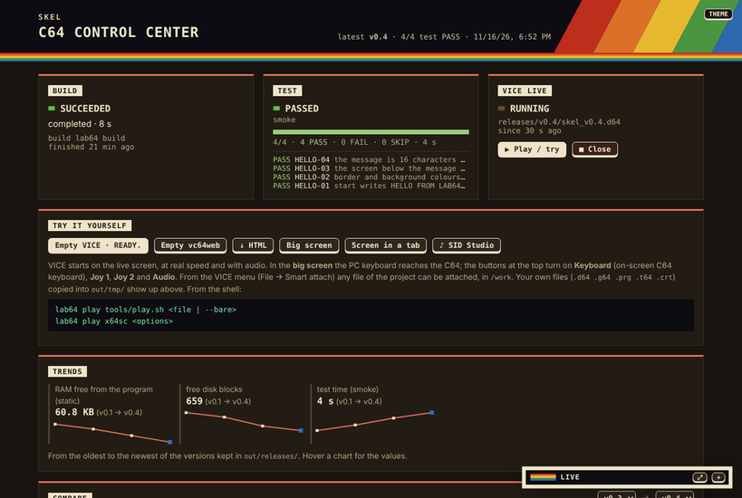

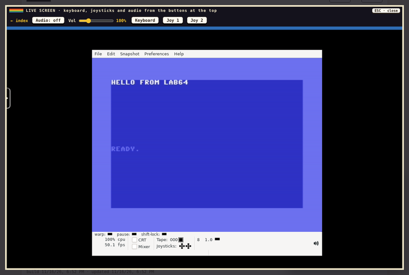

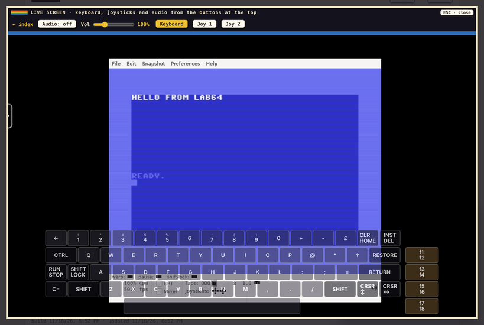

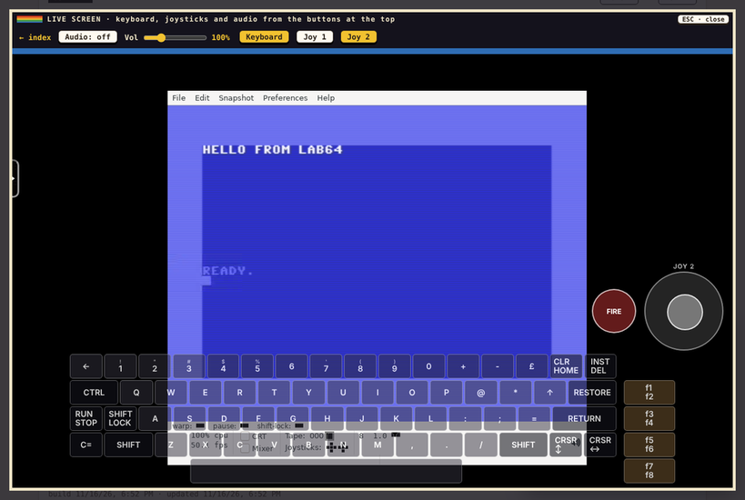

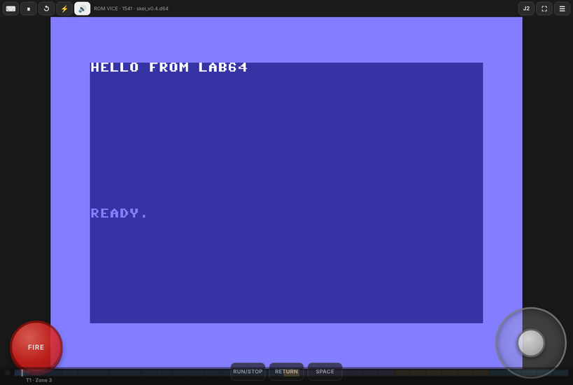

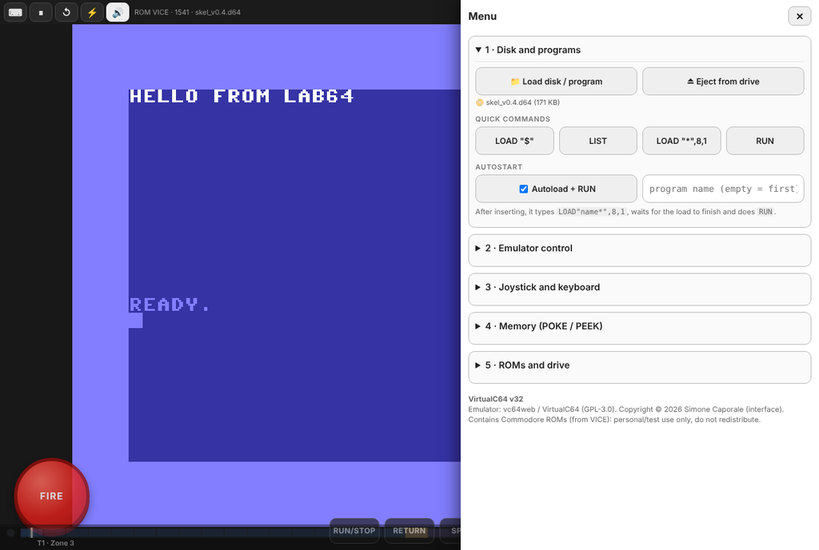

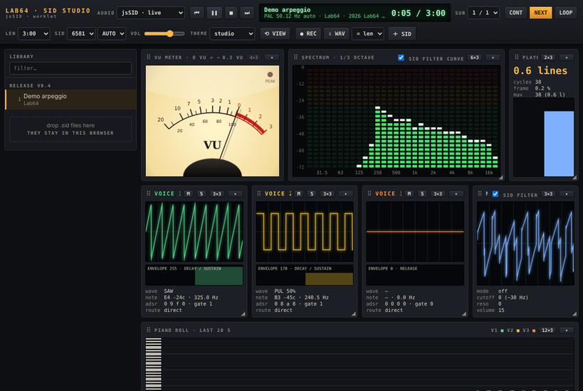

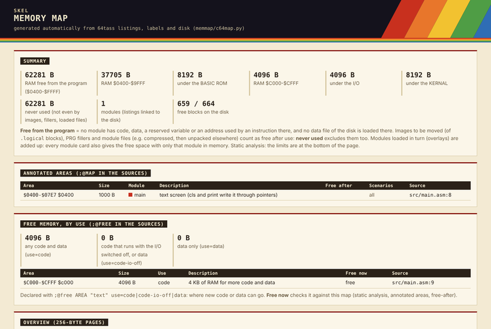

## Documentation

| Document | Topic |
|---|---|
| [Getting started](docs/getting-started.md) | tutorial: install, first project, everyday commands |
| [Architecture](docs/architecture.md) | repository layout, host and container sides, paths, scripts |
| [Command line](docs/command-line.md) | the `lab64` command and the compose services |
| [Configuration](docs/configuration.md) | the project skeleton made by `lab64 init` and every `lab64.env` setting |
| [Docker images](docs/images.md) | the images, their contents and sizes, how to change Ubuntu |
| [External programs](docs/external-programs.md) | the third-party programs compiled into the images, versions and sources |
| [The viewer](docs/viewer.md) | control center, live screen, vc64web, SID Studio, `/render` endpoint |
| [Release publishing](docs/publishing.md) | `lab64 publish` and the release folders |
| [Manifest](docs/manifest.md) | `manifest.json` and the live status files read by the viewer |
| [Instruction manuals](docs/manuals.md) | `lab64 manual`: HTML to PDF, formats and themes |
| [Test engine and Python library](docs/testing.md) | `lab64 test`, the VICE library and the shared modules |
| [Rendering SID files](docs/sid-rendering.md) | `sidrender.py`: `.sid` to WAV / MP3 with sidplayfp |
| [Memory maps](docs/memory-maps.md) | `lab64 map` and the `;@map`, `;@free`, `;@scenario` annotations |
| [Memory maps of several programs](docs/memory-maps-programs.md) | one map per program on a disk that overlays programs |

Project files: [TODO.md](TODO.md) (open work), [THIRD-PARTY.md](THIRD-PARTY.md) (components, owners, licenses),
[LICENSE](LICENSE).
