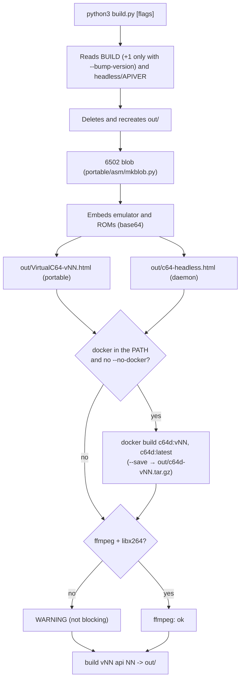
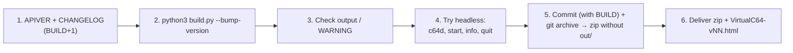
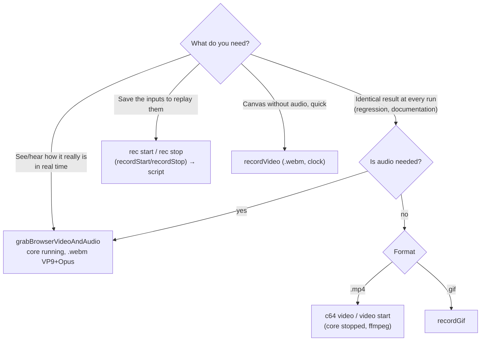

# c64-tools — VirtualC64 controllable from the command line

Copyright © 2026 Simone Caporale. The version (build and API) is in `BUILD` and `headless/APIVER`; the file names in `out/` contain it.

## Repository layout
```
build.py                generates everything in out/ (or in --out DIR) and, if Docker is present, the image; ROMs from --vice-roms
BUILD                   build number, incremented by build.py only with --bump-version
README.md  (CHANGELOG.md in docs/)
Dockerfile  docker-compose.yml  .dockerignore  .gitignore
docs/                   c64-cli.md (EVERY command explained), C64-API.md (API), scripting.md (scripts), C64-TODO.md (limits and things to verify), CHANGELOG.md, INCLUSION.md (how it sits in the game)
examples/               runnable examples: scripts/ (input), loops/ (JS loops), shell/ (commands), tools/ (test D64)
headless/               SOURCES of the remote control: c64d.js (daemon), c64 (client), c64-batch (parallel runs), c64-api.js, headless.template.html, APIVER, package.json
portable/               SOURCES of the standalone page (shell.html, asm/): does NOT work without a build
third-party/            emulator and documentation of the external components, one folder per component with a README (what it is, origin, license)
roms/                   ROMs: vice-roms/{C64,DRIVES}/ (see Lab64 roms/); roms.md = which files are needed, SHA-256, licenses, where to find them
work/                   work folders mounted in Docker: games/, roms/ (extra ROMs), scripts/; the contents of games/ and roms/ do not go in the repository
out/                    (ignored by git) build result
```

## Build

### Command
```sh
python3 build.py                 # build with the current version (BUILD file unchanged)
python3 build.py --no-docker     # as above, without the Docker step
python3 build.py --bump-version  # first increments BUILD by 1 (for a release only)
python3 build.py --save          # with Docker: also saves out/c64d-vNN.tar.gz
```
**Do not use `--bump-version` for normal builds**: it is reserved for the release procedure, because it changes the `BUILD` file (the version number). For development or test builds use the command without flags.

Flags combine (e.g. `--bump-version --save`, release only). An unknown `--xxx` argument is **ignored without an error**. It can be run from the repository root or from any folder: paths are relative to the location of `build.py`.

| Flag | Effect |
|---|---|
| *(none)* | uses the number in `BUILD` as it is; `BUILD` is not changed |
| `--bump-version` | `BUILD` += 1 and the `BUILD` file is rewritten (then it must be committed) |
| `--no-docker` | skips the Docker step |
| `--vice-roms DIR` | Commodore ROMs (subfolders `C64/`, `DRIVES/`); default `roms/vice-roms` (env `C64_VICE_ROMS`) |
| `--out DIR` | folder of the generated pages; default `out` (env `C64_OUT`); the Docker image receives them with `--build-context pages=DIR` |
| `--tag NAME` | Docker image name; default `c64d` (env `C64_IMAGE`) |
| `--no-ffmpeg-check` | does not check ffmpeg (when the pages are generated where the daemon will not run) |
| `--save` | after `docker build`, runs `docker save c64d:latest | gzip` → `out/c64d-vNN.tar.gz`; effective only if Docker is present and there is no `--no-docker` |

### What it does, in order
1. Reads `BUILD` (and increments it only with `--bump-version`) and `headless/APIVER`; the version is `vNN` (NN with two digits).
2. **Deletes `out/` entirely and recreates it**, at every run and with any flag. Do not keep your own files in `out/`. The deletion happens before any check: if the build fails, `out/` stays empty or incomplete.
3. Assembles the 6502 blob (about 2.8 KB) embedded in the pages (`portable/asm/mkblob.py`, writes a temporary file in `out/` and then deletes it).
4. Reads the emulator (`third-party/vc64web`) and the ROMs (`--vice-roms`, default `roms/vice-roms`; list in `roms/roms.md`) and embeds them in base64.
5. Writes `out/VirtualC64-vNN.html` (portable: all the compatible ROM variants, selectable from a menu; default Kernal 901227-03, chargen 901225-01, drive 1541-II).
6. Writes `out/c64-headless.html` (emulator only, standard ROMs and the two drive ROMs 1541/1541-II; other ROMs on request with `c64 rom`).
7. If `docker` is in the PATH and there is no `--no-docker`: `docker build` with tags `c64d:vNN` and `c64d:latest` (context = repository, filtered by the `.dockerignore` allowlist). If Docker is missing it prints a message and continues.
8. Checks `ffmpeg` (in the PATH and with the `libx264` encoder): if missing it prints a **WARNING**, the build does **not** fail (see "ffmpeg" below).

A successful build ends with `build vNN api NN -> out/` and exit code 0. The ffmpeg warning does not change the exit code; an error in the other steps (missing file, failed `docker build`) stops the build with a non-zero code.

Diagram:



### Result (`out/`, ignored by git)
- `VirtualC64-vNN.html` — **portable** page: a single file with emulator and ROMs embedded (no remote control). It also works from a phone, offline.
- `c64-headless.html` — minimal page opened by the `c64d.js` daemon.
- (with `--save` and Docker) `c64d-vNN.tar.gz` — exported Docker image.
- Docker image `c64d:vNN` / `c64d:latest`, in the local Docker (not in `out/`).

`portable/` and `headless/headless.template.html` are **sources**: without `build.py` there is nothing to open. The headless Node code (`c64d.js`, `c64`, `c64-api.js`) has no build step; only `out/c64-headless.html` is needed.

### Build requirements
Python 3 (standard library only). For the Docker step also Docker. ffmpeg is not needed to build: missing → only a warning. Details and links in the table below.

### Versions
- **Build** (`BUILD`): number in the names of the files and of the zip. Changes only with `--bump-version`.
- **API** (`headless/APIVER`): integer version of `c64-api.js` (`c64.apiVersion`). **Updated by hand** when the API changes; the daemon injects it into the page in place of `/*__API__*/`. `build.py` reads and prints it, it does not change it.
- Every build has an entry in `docs/CHANGELOG.md` (most recent at the top).

### Release procedure


1. Update `headless/APIVER` if the API changed and write the entry in `docs/CHANGELOG.md` (new build number = `BUILD`+1).
2. `python3 build.py --bump-version` (add `--save` to export the image).
3. Check the output: no unexpected WARNING, `build vNN api NN -> out/`.
4. Try at least the headless: `cd headless && node c64d.js &`, `node c64 start`, `node c64 info`, `node c64 quit`.
5. Commit (including `BUILD`), then zip the repository **without `out/`**: `git archive --format=zip --prefix=c64-tools/ -o c64-tools-vNN-apiNN.zip HEAD`.
6. Deliver the zip and `out/VirtualC64-vNN.html`.

### What is not verified
- The `docker compose` step and `--save` were never run by the package author. (In the game project the image is built with `docker build` and used by the `EMU-*` tests: see `docs/INCLUSION.md`.)
- Minimum Node version not verified (tested with 22).
- Build not tested on Windows/macOS (paths handled with `pathlib`, but not tested).

## What to install (external tools, not included)
| Tool | What it is for | Where it must be |
|---|---|---|
| Python 3 — https://www.python.org | `build.py` (standard library only) | `python3` in the PATH |
| Node.js — https://nodejs.org (tested with 22; minimum version not verified) | `c64d.js` daemon and `c64` client (the client uses only standard Node modules) | `node` in the PATH |
| Playwright — https://playwright.dev (npm) | drives Chromium for the daemon: **the only external Node module** | `cd headless && npm install` (creates `headless/node_modules/`), or global: `npm i -g playwright` with `NODE_PATH=$(npm root -g)` |
| Chromium (downloaded by Playwright) | runs the page | `npx playwright install chromium` (Playwright cache, usually `~/.cache/ms-playwright`) |
| ffmpeg — https://ffmpeg.org/download.html | deterministic videos (`c64 video`, `video start` in scripts) | `ffmpeg` executable in the PATH |
| Docker — https://docs.docker.com/get-docker/ | only to build/use the image | `docker` in the PATH |
| git — https://git-scm.com | repository | — |
In the container (Dockerfile) ffmpeg, Playwright and Chromium are already installed.

### ffmpeg
At the end of the build `build.py` checks that `ffmpeg` is in the PATH and has the `libx264` encoder; if missing it prints a **WARNING** and the build does **not** fail. Without ffmpeg everything works except the deterministic videos (`c64 video`, `video start` in scripts); the browser video+audio (`grabBrowserVideoAndAudio`) does not use it.
- Linux (Debian/Ubuntu): `sudo apt install ffmpeg`
- macOS: `brew install ffmpeg`
- Windows: download a build from https://www.gyan.dev/ffmpeg/builds/ (or https://github.com/BtbN/FFmpeg-Builds/releases), extract it and add the `bin` folder to the PATH; alternatively `winget install ffmpeg` (package id not verified).
- Official site / other platforms: https://ffmpeg.org/download.html
- Check: `ffmpeg -hide_banner -encoders | grep libx264` (Windows: `| findstr libx264`) must print one line.

## Recordings
There are five ways to record, with different guarantees. Choose based on what you need.

| What | How | Emulator | Time | Audio | Output | Repeatable |
|---|---|---|---|---|---|---|
| Deterministic video from a script | `c64 video`, `video start` in scripts | stopped (`pause`) | emulated, exact | no | `.mp4` (ffmpeg) | yes |
| Video + audio from the browser | `grabBrowserVideoAndAudio` | running (`resume`) | computer clock | yes | `.webm` (VP9 + Opus) | no |
| Deterministic GIF animation | `recordGif` | stopped | emulated | no | `.gif` | yes |
| Canvas video, no audio | `recordVideo` | stopped or running | clock | no | `.webm` | no |
| Inputs recorded as a script | `rec start` / `rec stop`, `recordStart`/`recordStop` | any | relative to the start | — | text script | yes (replayable) |

Choosing the method:



### Deterministic video (`c64 video`, `video start`)
The screenshot is taken **inside the page** every `every` emulated frames, and each frame is sent through a pipe to an `ffmpeg` on the daemon side. The video runs at `fps = 50 / every` (default `every=2`, so 25 fps). It requires the emulator stopped and `ffmpeg` in the PATH. It is silent.
```sh
node c64 pause
node c64 --out intro.mp4 video ../work/scripts/example.txt '{"every":2,"scale":3}'   # from a script file
node c64 --out idle.mp4 video 250 '{"every":4}'                                   # N frames
```
Inside a script (`docs/scripting.md`, §5):
```
video start intro every=2 scale=3
...
video stop
```
Closing: by default the video is closed at the end of the script, also on error (`video start clip` = `autostop`). With `keep` it stays open after the script and is closed with `c64 --out clip.mp4 videoStop`.

### Video + audio from the browser (`grabBrowserVideoAndAudio`)
A browser `MediaRecorder` records the canvas and the page audio. Not synchronized with the emulator: it does not stop it and does not advance its time. Use it with the emulator running.
```sh
node c64 resume
node c64 grabBrowserVideoAndAudio '{"action":"start","keyboard":"below","joy2":"below"}'
node c64 --outdir ../output script ../work/scripts/example.txt
node c64 --out clip.webm grabBrowserVideoAndAudio '{"action":"stop"}'
ffmpeg -i clip.webm clip.mp4                       # optional conversion
```
Options: `keyboard`, `joy1`, `joy2` = `none` (default) | `below` | `overlay`; `scale` 1-4 (default 2); `fps` (50); `bitrate` (4000000); `audio` (true). With `{"seconds":N}` it records N seconds and stops by itself (blocks the daemon for N seconds).
`stop` returns `audioPeak` (0-1, ~0 = silence) and `warnings`: check them.
The command panel shows pressed keys and joysticks live. **Not available inside scripts**: scripts have no `grab` command; the combination is done in three steps from the CLI (see above).

### Deterministic animation (`recordGif`)
One frame every `every` emulated frames, deterministic, with the emulator stopped.
```sh
node c64 pause
node c64 --out clip.gif recordGif '{"frames":60,"every":2}'
```

### Canvas without audio (`recordVideo`)
Real-time canvas video with `MediaRecorder`, without audio. If the emulator is stopped it advances `frames` frames; otherwise it records for `seconds`. Options: `frames` or `seconds`, `fps`, `scale` (1-4), `bitrate`, `mime`. For video with audio use `grabBrowserVideoAndAudio`.

### Inputs recorded as a script (`rec`, `recordStart`)
Records input events (keys, joystick, `text`) and exports them as a replayable text script. It does not record video.
```
rec start session            # session.txt
...
rec stop
```
From the CLI: `node c64 recordStart`, then `node c64 recordStop '{"format":"text"}'`. Events that cannot be expressed as a script line (for example `poke`) end up as a `# not exported` comment. The exported time is relative to the start of the recording.

### Limits and things not verified
- The deterministic video runs in real time (1 s of video ≈ 1 s of clock, also with a bot inside `runLoop`) and requires `ffmpeg` in the PATH (see "ffmpeg" above). The other ways do not.
- No way records audio **and** video deterministically: the core audio is not deterministic (`docs/C64-API.md`).
- In the grab, `start` returns when the `MediaRecorder` has been started, not when the first frame arrived. A delay between recorder start and `resume` is not excluded with certainty: for now there is no wait on the `onstart` event.
- Audio/video synchronization of the grab at the end of the recording: not verified (two different clocks).
- Long durations (memory of the `MediaRecorder` blocks) and `keep` videos of many minutes: not tested.
- Docker Compose: not tested.

## Headless (daemon + client)
**There is no build step for the code** (`c64d.js`, `c64`, `c64-api.js` are executable sources as they are); only `out/c64-headless.html`, generated by `build.py`, is needed. The only external Node module is `playwright`.
```sh
python3 build.py --no-docker
cd headless && npm install && npx playwright install chromium
node c64d.js &                                  # port 7064 (--port, --page, --api)
node c64d.js --headed &                         # as above but with the emulator window visible (a display is needed; see docs/c64-cli.md §2)
node c64 start ; node c64 sendText 'print"hello"\n' ; node c64 screenText ; node c64 quit
node c64 docs regress                           # documentation (docs/C64-API.md)
```
- Input scripts: `node c64 --outdir ../output script ../work/scripts/example.txt` — see `docs/scripting.md`.
- Deterministic (silent) video: `node c64 pause ; node c64 --out clip.mp4 video test.txt`.
- Real-time browser video + audio: `node c64 resume ; node c64 grabBrowserVideoAndAudio '{"action":"start","keyboard":"below","joy2":"below"}'` … `node c64 --out clip.webm grabBrowserVideoAndAudio '{"action":"stop"}'`.
- Regression: `node c64 regress save NAME`, `regress check NAME` (exit 0/1).
- **To start**: `docs/getting-started.md`. **Reference of every command**: `docs/c64-cli.md`. **Runnable examples**: `examples/` (index in `examples/README.md`).
- Long jobs: `node c64 status` (running job, progress; does not wait in the queue) and `node c64 abort` (interrupts the running job, the emulator stays stopped). If a client is closed or killed the daemon interrupts its job by itself: no `pkill -9` needed.
- Screen text in screen code (also with custom charsets): `node c64 findText "TEXT"`, `runUntil '{"text":"TEXT"}'`, in scripts `wait text "TEXT" 5s`.
- Games: `node c64 games`, `node c64 game NAME` (folder `work/games/`, or `$C64_GAMES`).

## ROMs
`roms/vice-roms/` holds only ROMs compatible with the core (the others were removed, see the folder README). **Defaults**: Kernal 901227-03, Basic 901226-01, Chargen 901225-01, drive 1541-II. The portable page embeds them all (7 Kernals, 2 chargens, 1541 and 1541-II) and lets you choose from the menu; the headless page embeds only the defaults (plus the 1541) and the others are loaded on request:
```sh
node c64 roms 251104                         # list (roms/, $C64_ROMS = folders separated by ':')
node c64 stop ; node c64 rom kernal 251104-04 ; node c64 start
node c64 clearRoms                           # back to the defaults
```
Third-party ROMs you own (e.g. JiffyDOS, proprietary, not included): `c64.loadRom(kind, data)` — not verified that the core accepts them.

## Docker
`python3 build.py` generates `out/` and builds the image, which contains the **already built** headless page (`out/c64-headless.html`), `headless/` (daemon, client, API), `docs/C64-API.md` and `docs/scripting.md`, the ROMs (`roms/vice-roms`, copied from Lab64 `roms/` at build time) plus ffmpeg, Playwright and Chromium. It does not contain `portable/`, `build.py`, the changelog, `.git`, the built portable page nor anything else not needed at run time (allowlist in `.dockerignore`).
```sh
docker compose up -d --build                  # (build.py must already have generated out/)
docker compose exec c64 node headless/c64 start
docker compose exec c64 node headless/c64 game game.d64
docker compose exec c64 node headless/c64 --outdir /output script /scripts/example.txt
```
Volumes: `./work/games` → `/games` (game files: .d64 .g64 .prg .t64 .crt ...), `./work/roms` → `/roms` (extra ROMs, besides those of the repository), `./work/scripts` → `/scripts` (read only), `./output` → `/output` (produced files). Port 7064 published only on 127.0.0.1: the daemon has no authentication and `c64.eval` runs JavaScript. **`docker compose` was never tested** (the image itself is built and used in the game project).

## Before publishing
The HTML pages embed vc64web and the Commodore ROMs; the ROMs are also in the repository. See `third-party/README.md`: redistribution rights of the ROMs and license of vc64web **not verified**.
