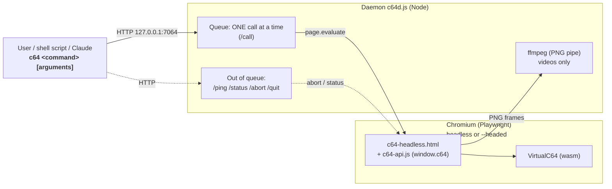
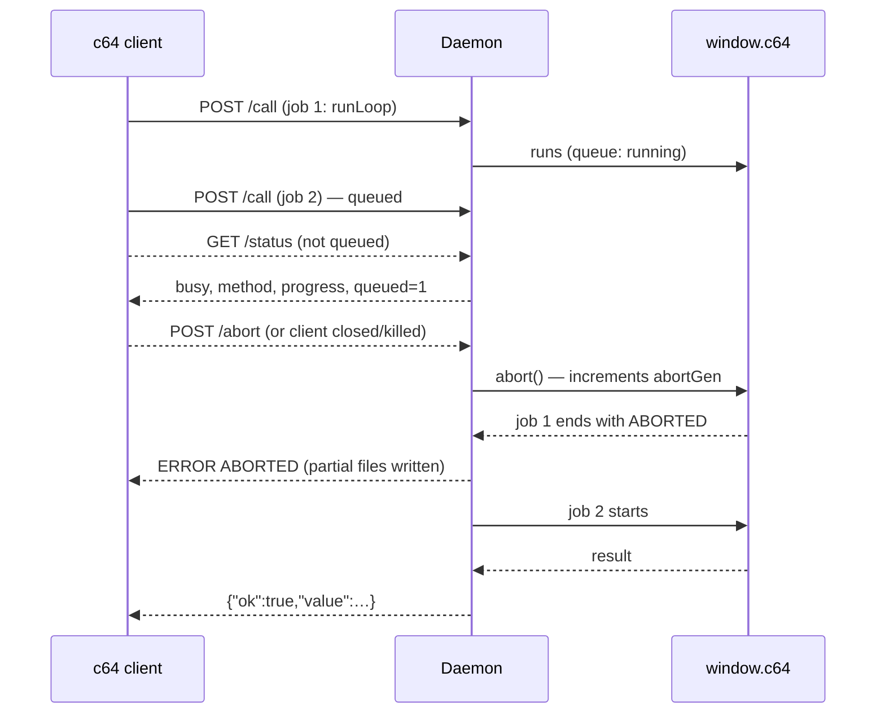

# c64 — complete command reference

Copyright © 2026 Simone Caporale. Valid for build 32 / API 25.

This document explains **every command** of the `c64` client and of the `c64d` daemon. The outputs shown were obtained by running the commands on a real daemon (build 25), unless stated otherwise (14/11: messages translated into English, outputs adapted). For the time model, the properties of the JavaScript API and the changes version by version see also `C64-API.md`; for script files see `scripting.md`; ready-made examples in `../examples/`.

Index: [1 Architecture](#1-architecture) · [2 Starting the daemon](#2-starting-the-daemon-c64djs) · [3 Client options](#3-global-client-options) · [4 Arguments and output](#4-how-arguments-are-passed-and-what-you-get) · [5 Client commands](#5-commands-of-the-client-and-of-the-daemon) · [6 Life cycle](#6-life-cycle-and-time) · [7 Input](#7-input-keyboard-and-joystick) · [8 Memory](#8-memory-and-labels) · [9 Screen](#9-screen) · [10 Disks and files](#10-disks-files-roms) · [11 Debug](#11-debug-cpu-chips-drive) · [12 States and regression](#12-states-and-regression) · [13 Recordings](#13-recordings) · [14 Scripts and loops](#14-scripts-and-control-loops) · [15 Misc](#15-misc-store-wasm-eval) · [16 Errors](#16-errors-and-exit-codes) · [17 What is not verified](#17-what-is-not-verified)

---

## 1. Architecture


- The **daemon** (`headless/c64d.js`) opens `out/c64-headless.html` in Chromium (headless, or with a visible window with `--headed`, §2) and injects `c64-api.js` into it.
- The **client** (`headless/c64`) sends one HTTP request per command to the daemon. Almost all commands are simply the name of a `window.c64` method with its arguments: `c64 peek 0x0400 8` = `window.c64.peek("0x0400", 8)`.
- Calls are **serialized**: one at a time, in order of arrival, because the emulator is deterministic only if nobody touches it in parallel. The exceptions are `ping`, `status` and `abort`, which bypass the queue and can be used while a job is running.
- The core stops between one call and the next after the deterministic commands (`runFrames`, `runUntil`, …): see "Time model" in `C64-API.md`. One PAL frame = 19656 cycles.

## 2. Starting the daemon (`c64d.js`)

```sh
cd headless
npm install && npx playwright install chromium     # once (see README)
node c64d.js [--page FILE] [--api FILE] [--port N] [--host H] [--headed]
```
| Option | Default | Meaning |
|---|---|---|
| `--page FILE` | `headless/c64-headless.html` if it exists, otherwise `out/c64-headless.html` | page to open (generated with `python3 build.py`) |
| `--api FILE` | `headless/c64-api.js` | API to inject into the page. The version (`APIVER`) replaces `/*__API__*/` |
| `--port N` | `7064` | HTTP port |
| `--headed` | absent (headless) | Chromium **with a visible window**: you see the emulator while you drive it from the CLI. Same as `C64_HEADED=1`. See "Windowed mode" below |
| `--host H` | `$C64_HOST` or `127.0.0.1` | listening address. **The daemon has no authentication and `eval` runs JavaScript**: do not expose it beyond localhost (in Docker it is `0.0.0.0` but the port is published only on `127.0.0.1`) |

Daemon environment variables: `C64_HEADED=1` (like `--headed`), `C64_HOST` (listening host), `C64_NO_SANDBOX=1` (Chromium without sandbox: needed in Docker/root), `NODE_PATH` (if `playwright` is installed globally: `export NODE_PATH=$(npm root -g)`). It prints `c64d ready on 127.0.0.1:7064 (c64-headless.html)` when ready. Stop it with `c64 quit`.

### Windowed mode (`--headed`)
```sh
node c64d.js --headed          # in another shell: node c64 start; node c64 type 'PRINT 1' …
```
The daemon, the CLI and all commands are identical: the only difference is that Chromium shows the window. Things to know:
- **A display is needed.** On Linux without `DISPLAY`/`WAYLAND_DISPLAY` the daemon exits with a message. It does not work in the Docker container as it is (no graphical server). On a remote server: `xvfb-run -a node c64d.js --headed` (virtual display, but then you do not see it).
- The page is the minimal one: it shows **only the emulator canvas**, without menus or on-screen keyboard. With the core stopped (after `runFrames`, `runUntil`, …) you see the last frozen frame; it animates only while the core runs (`resume`, `warp`, running job, video).
- **Closing the window ends the daemon** (like `c64 quit`).
- Do not touch the window during scripts, videos or regressions: real keyboard/mouse in the page can reach the emulator and break repeatability. Screenshots and videos are captured inside the page and do not depend on the window size.
- Real-time performance depends on the machine; deterministic mode does not change.

HTTP endpoints (to call it without the client):
| Request | Effect |
|---|---|
| `POST /call` `{"method":"peek","args":["0x0400",16]}` | calls a method → `{"ok":true,"value":…}` or `{"ok":false,"error":"…","code":"…"}` |
| `GET /ping` | `{"ok":true,"value":{"api":"c64d","port":7064,"page":"c64-headless.html"}}` |
| `GET /status` | running job and progress (like `c64 status`) |
| `POST /abort` | interrupts the running job (like `c64 abort`) |
| `POST /quit` | closes Chromium and ends the daemon |

### Several instances in parallel
Each daemon has its own Chromium and its own emulator: different ports are enough.
```sh
node c64d.js --port 7064 &  node c64d.js --port 7065 &
node c64 --port 7064 start ; node c64 --port 7065 start     # two independent emulators
```
Tested with two instances (independent cycles). Each instance costs one Chromium (RAM); not tested with many. The temporary video files use the daemon PID, so they do not clash.

## 3. Global client options

`c64 [options] command [arguments…]` — options can be anywhere on the line.

| Option | Meaning |
|---|---|
| `--port N` | daemon port (default 7064) |
| `--host H` | daemon address (default `127.0.0.1`, or `$C64_HOST_CLIENT`) |
| `--out FILE` | if the result is binary (PNG screenshot, GIF, video, disk, exported state…) writes it to `FILE` instead of printing it; for `regress check` saves the difference image; for `regress save` saves the JSON baseline |
| `--outdir DIR` | folder where the files produced by a script are written (screenshots, videos, recordings). Default: current folder. Created if missing; only the base name of each file is used |
| `--compact` | JSON on one line (without it, objects longer than 100 characters are printed on several lines) |
| `--quiet` | does not print the result (the exit code remains) |

Other client variables: `C64_GAMES` (games folder, see `games`), `C64_ROMS` (extra ROM folders, see `roms`).

## 4. How arguments are passed and what you get

Each argument is converted like this, in order:
1. `@@path` and the file exists → the **text content** of the file (script, `.lbl` labels, JSON, JS code);
2. `@path` and the file exists → the file **in base64** (disks, ROMs, states, programs);
3. otherwise `JSON.parse` is tried: numbers (`10`), `true`/`false`, `null`, objects (`'{"frames":4}'`), arrays (`'[1,2,3]'`);
4. if it is not valid JSON it stays **a string**: that is why `0x0400`, `$C000`, `READY.` or a label (`start`) arrive as text and the API interprets them (addresses: `0x..`, `$..`, decimal, label).

Consequences to know:
- **Objects and arrays must be valid JSON**, so **no `0x..` inside** `{…}` or `[…]` as numbers: `'{"until":[0xFFFF]}'` is NOT JSON, it arrives as a string and the method receives a text instead of an object (tested: `trace` used the defaults and ran for minutes). Write `65535` or `"0xFFFF"` in quotes. Always use single quotes around JSON in the shell.
- A list of bytes must be given as a JSON array: `c64 poke 0x0400 '[1,2,3]'` (`poke 0x0400 1,2,3` is the string `1,2,3` and gives a base64 error).
- `sendText`: the `\n` sequence written in the shell (two characters) is turned into RETURN by the client.
- **Results**: a string is printed as it is, the rest as JSON. If a binary file is expected use `--out`.

Exit codes: `0` ok · `1` command error (message `ERROR CODE: text` on stderr) · `2` wrong usage · `3` daemon not reachable.

---

## 5. Commands of the client and of the daemon

They are not API methods: the client or the daemon handles them.

### `ping`
Checks that the daemon answers. `c64 ping` → `{"api":"c64d","port":7064,"page":"c64-headless.html"}`.

### `quit`
Closes Chromium and ends the daemon. Does not wait for running jobs.

### `status`
State of the running job. **Bypasses the queue**: it works also while another client is waiting.
```
$ c64 status
{"busy":true,"method":"runLoop","elapsedMs":3007,"queued":0,"progress":{"frozen":false,"cycles":5916456,"run":{"frames":1,"of":2},"loop":{"iterations":70,"frames":140,"of":3000}}}
```
`busy`: a job is running · `method`: the last method received · `queued`: waiting jobs · `progress.run`: frames run by the current `run` and total · `progress.loop`: iterations, frames and maximum of a `runLoop`. Idle: `{"busy":false,…,"progress":{"frozen":true,"cycles":…,"run":null,"loop":null}}`.

### `abort`
Flow of a job with `status` and `abort`:



Interrupts the running job (`runFrames`, `runUntil`, `runLoop`, script, video…): that job ends with `ERROR ABORTED` (exit 1; the files already produced, partial video included, are written); the emulator stays stopped; the queued jobs start. Answer: `{"aborted":true,"cycles":…}`. If a client is closed or killed while waiting, the daemon interrupts its job by itself.

### `help` (= `methods`)
List of all API methods with their signature (array of strings). Also `c64 methods`.

### `docs [WORD]`
Prints `C64-API.md`; with `WORD` only the sections (`## …`) whose title contains it: `c64 docs regress`, `c64 docs 17`. Looks for the file next to the client, in `docs/` and in `../docs/`.

### `roms [FILTER]`
Lists the ROM files (`.bin`, `.rom`) found in: `$C64_ROMS` (folders separated by `:`), `roms/vice-roms/`. With `FILTER` only the names containing it. Does not talk to the daemon.
```
$ c64 roms 251104
kernal-251104-04.bin  (8192 bytes)  ../roms/vice-roms/C64/kernal-251104-04.bin
```

### `rom KIND NAME`
Loads an alternative ROM in place of the embedded one: `KIND` = `kernal` | `basic` | `chargen` | `floppy` (also `drive`); `NAME` = file name or a part of it (must identify a single file, otherwise "ambiguous name"). Effective **from the next `start`**: `c64 stop; c64 rom kernal 251104-04; c64 start`.
```
$ c64 rom kernal 251104-04
{"kind":"kernal","bytes":8192,"name":"kernal-251104-04.bin","needsRestart":true}
```
`c64 rom` without arguments shows the active user ROMs: `{"user":{"kernal":{"name":"kernal-251104-04.bin","bytes":8192}},"driveRom":"1541-II","builtinDriveRoms":["1541","1541-II"]}`. To go back to the defaults: `c64 clearRoms`. The core emulates only the 1541 family (drive ROMs must be 16 KB); see the list of tested ROMs in `C64-API.md` (API 17).

### `games [FILTER]`
Lists the game files (`.d64 .g64 .d71 .d81 .nib .prg .p00 .t64 .tap .crt .vsf .zip`) found, also in subfolders, in `$C64_GAMES` (otherwise the first existing among `./games`, `<package>/work/games`, `/games` as in Docker).
```
$ C64_GAMES=./games c64 games
t.d64  (174848 bytes)
```

### `game NAME`
Attaches or loads a game file, looking it up by name (part of the relative path; must be unique). Disk images (`.d64 .g64 .d71 .d81 .nib`) go into drive 8 (`attach`); the other formats with `loadFile`. Answers with the state (`state()`). Tested only with `.d64`; `.prg`, `.t64`, `.crt` not tested.
```
$ c64 game t.d64
{"started":true,…,"disk":"t.d64","disk8":true,…}
```

### `regress save NAME [options]` · `regress check NAME|@@file.json [options]` · `regress list`
Regression baseline and comparison: see [12](#12-states-and-regression).

### `video FILE.txt|FILE.js|N [options]`
**Deterministic** video (frame by frame, silent) with ffmpeg: see [13](#13-recordings).

### `script FILE [options]` · `scriptCheck FILE`
Runs / validates an input script from a text file: see [14](#14-scripts-and-control-loops).

---

## 6. Life cycle and time

| Command | What it does |
|---|---|
| `start [opts]` | Starts the emulator and waits for the boot (core beyond 3 million cycles and running). `opts` JSON: `disk:{name,data}` (base64 image), `driveRom` (`"1541"`\|`"1541-II"`), `roms:{kernal:…,basic:…,chargen:…,floppy:…}` (base64), `port` (1\|2, joystick port), `autoload` (true/false), `program` (name of the program to load), `timeout` (ms, default 30000). Returns the state. `c64 start` ≈ 5 s. After `start` the emulator is **running**. |
| `ready [timeoutMs]` | Waits for the core to be running and past the boot; returns the state. With the core **stopped** it cannot succeed: `TIMEOUT` after 30 s. |
| `stop` | Stops and powers off the emulator (`start` restarts it, also with new ROMs). |
| `reset [{"hard":true}]` | Reset (like the RESET button). With `hard`: power off/on (the cycle counter restarts from 0). After a reset the KERNAL ignores the keyboard for about 140 frames (see `C64-API.md`). |
| `pause` | Stops the core (`frozen=true`). From here `peek`/`poke`/`regs`/screenshots work on a frozen state. |
| `resume` | Puts the core back to real-time running (≈ 985 000 cycles/s). If it resumes less than 260 ms after a stop, it waits for the rest. |
| `warp true\|false` | Core warp: runs faster than real time (not exact). Returns `true`. |
| `state` | State: `{started,injected,port,kbd,disk,running,frozen,warp,cycles,disk8,driveRom,roms}`. Before `start`: `{"started":false,…,"error":"emulator not started: call c64.start()"}`. |
| `info` | `{"build":"v27","api":25,"core":"VirtualC64 5.x (vc64web)","driveRom":"1541-II"}`. |
| `cycles` | CPU cycles since power on. |
| `frames` | Whole frames (cycles ÷ 19656). |
| `framesExact` | Frames with the fractional part. |
| `runFrames N` | Runs **exactly N frames** and **stops** the core. Returns `{reason:"frames",cycles,frames}`. With `'{"fast":true}'` as second argument it uses warp for the bulk and the last frames at normal speed (exact unless `exact:false` in the result). After `call`/`runUntil` the number of frames can be fractional (e.g. `2.98`). **API 23: exact even if the browser is late**: before each advance a snapshot is taken (≈5 ms), if the core overshot by one frame it is restored and repeated (field `retries` in the result). `'{"exact":false}'` = previous behavior (no snapshot; rarely +1 frame). |
| `runCycles N` | As above, rounding up to whole frames (the core has no finer granularity). |
| `runUntil COND [options]` | Runs until the condition is true, then stops. See below. |
| `waitFor TEXT [ms]` | Waits **in real time** (checks every 150 ms, default 15000 ms) for `TEXT` to appear on screen (KERNAL text, case insensitive): `true` if it appears, `false` on expiry (not an error). It does not advance the core: with the core stopped it never appears. With the core stopped use `runUntil` or `wait` in scripts. |
| `sleep MS` | Daemon pause in milliseconds (real time, not emulated). Returns `null`. |

**`runUntil COND [options]`**: `COND` is a JSON object. The memory and screen conditions (`addr`, `mem`, `screenText`, `screenRegex`, `text`, `screenMatch`, `cycles`, `when`) combine in OR: the first one that happens wins; with `{"all":true}` among the options all must hold. `pc`, `pcIn` and `watch` stop the run anyway when they happen.
| Condition | Meaning |
|---|---|
| `{"pc":"$0840"}` or `{"pc":[a,b]}` | PC at the address (stops on the exact instruction); number, `$..` string, label or array |
| `{"pcIn":[a,b]}` | PC in a range (max 64 addresses) |
| `{"addr":A,"value":V,"mask":M,"not":false}` | `mem[A] & M == V & M` (or `!=` with `not`) |
| `{"mem":[A,V]}` | `mem[A] == V` (third element: mask) |
| `{"watch":A}` or `[a,b…]` | access to the address (watchpoint, max 16); stops AFTER the instruction |
| `{"screenText":"READY."}` / `{"screenRegex":"^READY"}` | text (KERNAL, case insensitive) / regular expression on the screen |
| `{"text":"TEXT"}` or `{"text":[18,5,1,4,25]}` | text in **screen code** (API 18): works also with custom charsets. `findText` options in `{"textOpts":{"addr":…,"map":…}}` (API 20/21) |
| `{"screenMatch":"NAME","maxDiff":0,"tolerance":0,"rect":{…}}` | the screen matches the one saved with `screenSave NAME` (at most `maxDiff` different pixels) |
| `{"cycles":N}` | total cycles reached |
| `{"pc":A,"whenRegs":{"x":3}}` | (API 21) with `pc`: stops only if registers `a`,`x`,`y`,`p` have the given values; otherwise resumes. Each stop reads the registers with `regs` (≈40 extra cycles). For now only with `pc`. **Slow**: ≈0.2 s of clock per stop (measured: 100 stops in 18 s), because each stop needs 3 halt/run of the core with the wait that avoids frame catch-up; unusable with large timeouts if the PC passes often |
| `{"when":{"addr":A,"value":V}}` | memory condition during the run |
Options: `{"timeoutFrames":3000}` (default 3000, **not a limit**: it can be raised), `{"all":true}`. Returns `{reason:"cond"|"pc"|"watch"…,cycles,frames}`; on expiry error `TIMEOUT: timeout: mem[$0002]==$FF not reached in 5 frames`. Runs go in real time (4000 frames ≈ 80 s).
```
c64 runUntil '{"text":"READY."}'
c64 runUntil '{"mem":[2,255]}' '{"timeoutFrames":5}'
```

---

## 7. Input: keyboard and joystick

Input goes into the core **keyboard matrix** and joystick ports. Times are in emulated frames. A key must be held at least 1 frame and released at least 2 before pressing it again (otherwise the press can be lost).

| Command | What it does |
|---|---|
| `type KEY [options]` | Presses **one key** (character or name: `w`, `RETURN`, `F1`, `RUN/STOP`, `SHIFT+A`) or **several simultaneous keys** with a JSON array `'["w","d"]'`, waits for the release. Options: `frames` (default 3, min 1), `releaseFrames` (default 3, min 2), `shift`/`ctrl`/`cbm` (true), `noWait`. Returns `{keys:[…],frames}`. After a reset it waits for the boot (`{"noWait":true}` to avoid it). |
| `keyDown KEY` | Holds the key (effective from the next emulated frame). |
| `keyUp KEY` | Releases. |
| `sendText TEXT [options]` | Types a string into the keyboard matrix (does not write `$0277`); `\n` = RETURN. Tokens in braces: `{RUN/STOP}` `{F1}`…`{F8}` `{HOME}` `{CLR}` `{DEL}` `{INST}` `{UP}`… `{SHIFT+A}` `{CTRL+3}` `{C=+Q}` `{WAIT:30}` (waits 30 frames) `{{}` (the brace). Options: `framesPerKey`, `releaseFrames`, `keepCase`, `noWait`. Returns `{keys,frames}`. E.g.: `c64 sendText 'print 6*7\n'` → `{"keys":10,"frames":61}`. |
| `keyNames` | List of keys: `{keys:[matrix names],named:[RUN/STOP, F1…],shifted:[…]}`. |
| `joy …` | Joystick, two forms: **single direction** `joy up 1 [port]` (1 = pressed, 0 = released; directions `up down left right fire`); **full state** `joy PORT '{"up":true,"fire":true}' [frames]` — with frames it holds the state for that time and releases (advances emulated time). Returns `true`. The default port is the one chosen with `start({port})` (default 2). |
| `joyPulse DIR [ms] [port]` | Presses and releases after `ms` (default 150) **of clock**. With the core stopped nothing visible happens (deduced from the code, not tested). |
| `fire [ms] [port]` | `joyPulse fire` (default 120 ms). |
| `sendJoy "R10 UF8 W5 L3" [{"port":2}]` | Joystick sequence: letters `U D L R` (directions) and `F` (fire) held N frames (`R10`, `UF8` = up+fire for 8); `Wn` = wait n frames. Returns `{frames:26}`. |

Inside `runLoop`, `joy(port,state,frames)` does not advance time (see `C64-API.md`, API 18).

---

## 8. Memory and labels

Addresses can be written `0x0400`, `$0400`, decimal or as a **label** (`start`, `lobby:name` for a set).

| Command | What it does |
|---|---|
| `peek A` | One byte (memory as the CPU sees it: ROM and I/O visible according to `$01`). `c64 peek 0x0400` → `32`. |
| `peek A N [{"ram":true}]` | Array of N bytes. `ram:true` = pure RAM (ignores `$01`, temporarily sets the map). |
| `peekRange A N` | Like `peek A N`. |
| `peekWord A` | Little-endian 16-bit word: `c64 peekWord 0xFFFC` → `64738`. |
| `poke A V [{"ram":true}]` | Writes a byte or a JSON array (`'[1,2,3]'`). Returns the number of bytes written. Writes to chips (VIC, SID…) behave as for the CPU. |
| `pokeRange A '[…]'` | Like `poke` with an array. |
| `dump A N` | Hex, 16 bytes per line: `FFFC: E2 FC 48 FF …`. |
| `find BYTES\|TEXT [{"from","to","ram","screen","max"}]` | Looks for a sequence (byte array or ASCII string; with `screen:true` as screen codes). Returns the addresses (max 256). `c64 find READY` → `[41848]`; with `screen:true` → `[1224,1384]`. |
| `ramSnap NAME [{"from","to"}]` | Snapshots a range (default `$0000–$FFFF`, RAM view). |
| `ramDiff A B [{"max"}]` | Differences between two snapshots (`B=null` = current state): `{count,changes:[{addr,a,b}]}` (max 1000). Useful to find the address of lives/score. |
| `loadLabels @@FILE.lbl [{"set":"name","activate":false}]` | Loads VICE labels (`al C:0840 .name`) or `name = $0840`. Returns how many. `set` = separate set (read with `lobby:name`). |
| `label NAME` | Address (number) of a label. |
| `useLabels SET` | Activates a set: `{"set":"default","count":2}`. |
| `labelSets` | Loaded sets and how many labels: `{"default":2}`. |
| `stateHash [{"only","exclude"}]` | Hash per component (Memory, CPU, CIA1/2, VIC, SID, Drive…) + overall hash: to compare two states. The CPU hash is unstable. |

---

## 9. Screen

The page renders the screen at 384×270 (PAL visible area). After a `poke` on a VIC register advance at least one frame before taking a screenshot (otherwise the image is the previous one).

| Command | What it does |
|---|---|
| `screenInfo` | Where the VIC reads: `{bank,screen,charset,charsetRom,lowercase,bitmap,ecm,multicolor,textMode}`. |
| `screenText` | The 25 text lines from screen RAM (screen code → text conversion with the standard character set). |
| `screenCodes` | The 1000 raw screen codes (array), independent of the charset. |
| `findText TEXT\|CODES [{"raw","all","exact","addr","len","map","enc"}]` | Looks for text **in screen code**: `{row,col,addr}` or `null`; `all:true` → list. Letters case insensitive, bit 7 (reverse) ignored unless `exact`. `c64 findText READY.` → `{"row":5,"col":0,"addr":1224}`. `addr`: alternative screen RAM address (API 20). Does not see graphic glyphs nor text on the bitmap. `map` (API 21): game's own encoding, e.g. `{"0-9":45,"/":55}` (character or range `a-b` → starting code); the text is translated with the map (missing character = `BAD_ARG`) and the comparison is exact. `c64 findText '198/198' '{"addr":33792,"map":{"0-9":45,"/":55}}'`. **Warning**: with `addr` on an area that is not a screen (e.g. font data) a text can give false positives: use `map` or an array of codes. **API 23**: `enc` = encoding loaded with `loadEncoding` (characters can be added with `map`); `len` = linear search in `[addr, addr+len)` without 40-column paging, returns `{offset,addr}` (for buffers like the monster name: `c64 findText 'LORD OF RUIN' '{"addr":"nbuf","len":24}'`); `addr` accepts labels (`"nbuf"`, `"$8400"`). With `map`/`enc` upper and lower case are equivalent if the map has only one of the two. The map can be character by character (non-contiguous letters). |
| `loadEncoding NAME MAP\|@@file.cdef [{"block"}]` | (API 23/24) Registers a named encoding: JSON object (`{"0-9":45,"/":55,"A":57,…}`) or text with 64tass `.cdef` lines (`.cdef "09", 45` range, `.cdef "A","F",57` range, `.cdef "/", 55` single; `;` comment). **API 24**: the code can be a symbol (`.cdef "A","A",G_A`) resolved from `NAME = value` lines of the same text (also `$hex`, `%bin`) or from the labels loaded with `loadLabels`; with `.enc "name"` blocks only the `.cdef` lines of the block with the encoding name are read (or `{"block":"name"}`). This way a game's `gfx_consts.inc` can be loaded directly: `c64 loadEncoding hud @@out/gfx_consts.inc`. Tested on a file with the same structure described in the report, not on the real file. |
| `encodings` | (API 23) Loaded encodings: `{name: number of characters}`. |
| `border` · `background` | Border / background color (0–15). |
| `cursor` | `{col,row}` of the KERNAL cursor. |
| `screenshot` | PNG as data URL; with `--out f.png` writes it to a file. Options: `'{"rect":{"x":0,"y":0,"w":8,"h":8}}'` crop; `'{"raw":true}'` → `{width,height,data:base64 RGBA}`. |
| `screenSave NAME` | Saves the current screen in memory. |
| `screenDiff A B [options]` | Compares two saved screens (`null` = current): `{same,diffPixels,ratio,width,height,bbox}`. Options `tolerance` (0–255 per channel), `rect`, `image:true` (PNG of the differences with `--out`). |
| `sprites` | The 8 sprites from the VIC registers: `{sprites:[{n,enabled,x,y,color,multicolor,expandX,expandY,behindBackground,pointer,dataAddr},…]}`. |
| `recordGif [{"frames","every","rect"}]` | Advances `frames` frames (emulator stopped) capturing one every `every` and returns an animated GIF: `c64 --out a.gif recordGif '{"frames":10,"every":5}'`. |

---

## 10. Disks, files, ROMs

**Disks are attached with the core running.** With the core stopped the image appears "loaded" in `state().disk` but the drive does not see it (`disk8:false`, `diskImage` → "no disk in drive 8"): do `resume` before `attach`/`loadFile`.

| Command | What it does |
|---|---|
| `loadFile NAME @FILE [options]` | Loads `.d64 .g64 .prg .t64 .crt …`. Options: `autoload` (true: automatic LOAD + RUN for disks), `program` (program name), `wait` (false = do not wait for the end of the autoload), `timeout` (ms). With autoload it does a **reset**: `poke`s done before are lost; do them after the command returned. Returns the state. |
| `attach 8 @FILE NAME` | Attaches a disk to drive 8 without autoload (drive 8 only). |
| `detach` / `eject` | Ejects the disk. |
| `diskImage [8] [{"bytes":true}]` | The image of the current disk (also after a `SAVE`), base64: `c64 --out out.d64 diskImage` → `written out.d64 (174848 bytes)`. |
| `driveState [8]` | `{type,hasDisk,motor,powerSave,syncMark,readMode,halftrack,track,headOffset}` (the LED is not exposed). |
| `driveTrace FRAMES [{"every","drive"}]` | Head position over time (one sample every `every` frames, the core advances). |
| `loadRom KIND @FILE [{"name"}]` | User ROM in place of the embedded ones (effective from the next `start`): `kernal` (8192 bytes), `basic` (8192), `chargen` (4096), `floppy` (16384, 1541 family only). By name: the `rom` command. |
| `clearRoms [KIND]` | Back to the embedded ROMs (all or one). |
| `roms` | **Note**: on the command line `c64 roms` is the client command that lists the files (§5); the API `roms()` is reached with `c64 rom` without arguments. |

---

## 11. Debug: CPU, chips, drive

For almost all of them the core must be **stopped** (`pause`) or becomes so after the call.

| Command | What it does |
|---|---|
| `regs` | `{pc,line,cycle,cycles,a,x,y,p,sp}`. A/X/Y/P/SP are read with a small 6502 stub (33 bytes of RAM at `$0334–$0367`, restored, ~40 cycles). |
| `setRegs '{"a":5,"x":6,"pc":…}'` | Sets the registers (SP cannot be changed). Core stopped. |
| `breakpoint A` | Adds a breakpoint; returns the id. |
| `breakpoints` | List `[{id,addr}]`. |
| `clearBreakpoints` | Removes them all; returns how many. |
| `watch A` / `watch '[a,b]'` | Watchpoint (stops after the instruction that accesses the address); returns the ids. |
| `watchpoints` / `clearWatchpoints` | List / removes all. |
| `disasm A N` | Disassembles N instructions: `[{pc,bytes:"E2 FC",asm:"NOP #FC"},…]` (the core disassembler, illegal instructions included). |
| `step N` | Runs N instructions (≈ 20 ms each): `[{pc,bytes,asm,cycles}]` (`cycles` = value before the instruction). Core stopped. |
| `trace '{"until":[A],"max":N,"last":K}'` | Runs instructions **until the PC is in `until`** (or max, default 20000 ≈ 400 s!) and returns the last K (default 32): `{instructions,reached,pc,last:[…]}`. Post-mortem: `loadState` + `trace`. **Always** give a reasonable `max`. |
| `measure FROM TO [{"timeoutFrames","n"}]` | (API 21; `n` since API 22) **Exact** cycles between two PCs: runs to `FROM`, resets the count, runs to `TO`. With `{"n":50}` repeats 50 times and adds `{n,min,max,mean,samples}` (≈0.15 s of clock per repetition: 10 repetitions in 1.5 s). `c64 measure 0xC002 0xC005` → `{from,to,cycles:49,fromCycles,toCycles,frames}`. Labels allowed. Tested on a `DEX/BNE` loop (49 cycles as computed by hand); not compared with VICE. |
| `call A [{"a","x","y"}] [{"timeoutFrames","scratch","noWait","frames"}]` | `JSR A` and return; registers and PC restored; returns `{a,x,y,p}` on exit. Routine that does not return → `CALL_TIMEOUT` (restores only PC and the `$0334` work area). `noWait:true`: jumps to the routine with `JMP`, lets it run `frames` frames (default 2) and returns `{started,pc,frames}`. In scripts: `call ADDR nowait`. |
| `inspect NAME` | Internal state of a core component: `cpu mem vic cia1 cia2 sid c64 drive8 …` → `{config,state,raw}`. |
| `sid` | The 29 SID registers + decoding of the 3 voices (frequency, Hz, gate, waveform, ADSR…). |
| `sidTrace FRAMES [{"every"}]` | SID registers every `every` frames while the core advances (to check music). |
| `wasm NAME [arg…]` | Calls an exported core function (`wasm wasm_get_cpu_cycles`). Returns the value (BigInts become numbers or strings). |

---

## 12. States and regression

**States** (full snapshots of the core in JS memory, valid while the daemon is on):
| Command | What it does |
|---|---|
| `saveState NAME [{"export":true}]` | CPU, RAM, VIC, SID, CIA, drive, disk. `c64 saveState s1` → `{"name":"s1","size":790840,"cycles":10358712}`. With `export:true` and `--out f.bin` also saves the file (790 840 bytes in the tested case). |
| `loadState NAME\|@FILE` | Restores (cycles and RAM exactly as saved; breakpoints and watchpoints must be checked again). From a file: `c64 loadState @f.bin`. |
| `states` | List `{name:{size,cycles}}`. |
| `dropState NAME` | Deletes. |

**Regression**: the baseline contains component hashes, RAM (default `$0000–$FFFF`), screen (PNG) and cycles. It lives in the page while the daemon is on.
| Command | What it does |
|---|---|
| `regress save NAME [options]` | Creates/overwrites the baseline. JSON options: `ram:[[a,b],…]` ranges, `screen:false`, `only`/`exclude` (components). Prints `{name,cycles,hash,ram,screen}`. With `--out f.json` writes the full bundle to a file. |
| `regress check NAME\|@@f.json [options]` | Compares the current state with the baseline (name or file). Options: `ignore:["0x0400-0x07E7",…]` (excluded RAM ranges), `tolerance` (pixels), `only`, `exclude`, `ram`, `screen`, `strict`, `includeCpu`, `image` (with `--out f.png` saves the difference image), `maxGroups`. **Exit code 0 = PASS, 1 = FAIL** (with the reasons on stderr). The comparison makes sense only if you start from the same state (`loadState` + same inputs). |
| `regress list` | Existing baselines: `{name:{cycles,ram,screen}}`. |
| `regressSave` / `regressCheck` / `regressList` | The same API methods (they return the full JSON). |

---

## 13. Recordings

Overview and choice of the method: README, "Recordings" section. Commands:

| Command | What it does |
|---|---|
| `video FILE.txt\|FILE.js\|N [options]` | **Deterministic video**, silent. One frame every `every` emulated frames while an input script (`.txt`), a JS loop (`.js`, function body like `runLoop`) or N frames run; encoded by **ffmpeg** (libx264) in the daemon. Requires the core **stopped** (`pause`). Runs in real time (200 frames ≈ 4–5 s). JSON options: `every` (default 2 → `fps = 50/every`), `scale` (1–4, default 3 = 1152×810), `crf` (0–51, default 20), `fps`, `preset`. Usage: `c64 pause; c64 --out clip.mp4 video test.txt '{"every":2,"scale":3}'`. In scripts: `video start`/`video stop` (see `scripting.md` §5). |
| `videoStop` | Closes a video left open with `video start … keep`: `c64 --out long.mp4 videoStop`. |
| `grabBrowserVideoAndAudio '{"action":"start",…}'` | **Video + audio from the browser** in real time, not synchronized with the emulator (core running). Actions `start` / `stop` / `status`; with `seconds` it records and stops by itself. Options: `keyboard`, `joy1`, `joy2` = `none`\|`below`\|`overlay`, `scale` (1–4, default 2), `fps` (50), `bitrate`, `audio` (true), `audioGain` (default 1), `mime`. `stop` returns `{data,mime,bytes,seconds,width,height,audio,audioPeak,controls,warnings}`; `--out clip.webm` saves the file (webm VP9+Opus). |
| `recordVideo [{"frames"\|"seconds","fps","mime","bitrate","scale"}]` | Canvas video with `MediaRecorder` (real time, no audio). With the core stopped it advances `frames` frames. `c64 --out v.webm recordVideo '{"frames":20,"scale":1}'`. |
| `recordGif` | Animated GIF (§9). |
| `recordStart` · `recordStop ['{"format":"text"}']` | Records the input calls (`keyDown keyUp joy sendText type sendJoy fire joyPulse poke pokeRange`) with the relative frame. `recordStop` → `{startCycles,frames,events:[{f,m,a}]}`; with `{"format":"text"}` exports it as a text script (lines like `0 L 3`, `10 O 3`; events that cannot be expressed become `# not exported` comments). |
| `replay REC` | Repeats the recorded calls at the same relative frames: starting from the same state (`loadState`/`reset`) with the core stopped it is exact. |
| `capStart` · `capArm` · `capRun` · `capTake` · `capStop` · `capClipStop` | **Internal**: used by `video` and scripts to capture frames; not needed from the command line. |

---

## 14. Scripts and control loops

### `script FILE [{"noWait":true}]`
Runs an input script (`.txt`; syntax in `scripting.md`) inside the emulator with exact emulated time. `--outdir DIR` says where to write the screenshots, videos and recordings produced. Returns `{events,frames,warnings,outputs?,log?}`; on error: `ERROR CODE: script line N: …` (exit 1) and the files already produced are written anyway.
```
$ c64 --outdir out script k.txt
written out/k.png (screenshot)
{"events":3,"frames":25,"warnings":[],"outputs":[{"type":"screenshot","name":"k.png","mime":"image/png","line":3}]}
```
`noWait:true` does not wait for the boot after a reset.

### `scriptCheck FILE`
Validation only: `{"events":3,"warnings":[]}` or the error with the line number.

### `runLoop 'CODE' [{"frames":N,"every":2,"exact":true}]`
Runs a control loop **inside the page**: no HTTP call per step. `CODE` is the body of a JS function with parameters `(c64, i, state)`; `return false` ends it; `state` is an object that persists between steps and is returned; `every` = frames per step (default 2); `frames` = maximum. The code can be in a file: `c64 runLoop "$(cat bot.js)" '{"frames":4000}'`. Returns `{iterations,frames,state}`. Inside the loop `c64.joy(port,state,frames)` presses and releases without advancing time (API 18). Runs in real time (≈ 25 steps/s with `every=2`).
```
c64 runLoop 'const hp=c64.peek("c_hp"); if(hp===0) return false; c64.joy(2,{right:true},2);' '{"frames":3000}'
```
**API 23/24 — exact steps and diagnostics.** (API 24: fixed the API 23 defect that lost held joystick and keys at every repetition, see below.) Each step advances exactly `every` frames (same mechanism as `runFrames`: snapshot, check, restore). The result contains `framesActual` (from the cycles), `exact` (`framesActual == frames`), `retries:[[step,repetitions],…]` (steps where the core had overshot and was brought back; **at most 200 entries**), `retriesTotal` (API 25: the true total of repetitions, counted per advance: a step with a `joy`/`type` release in the middle makes two advances, so with `_forceRetry:1` the total can exceed the number of steps) and `retriesTruncated` (true if the list was cut). Before, one step every ~800–1000 advanced one extra frame when the browser was late and the returned counter did not show it: a closed-loop bot from the same state gave different outcomes. Measures: bot with variable CPU load, 1000 steps, 3 runs → identical hashes; 3 instances in parallel → more repetitions (5–8 over 150 steps) but identical outcome. Speed unchanged (real time). `{"exact":false}` = old behavior. Regression test: `examples/shell/11-determinism.sh [N] [STEPS]`.

**Checking that a bot is repeatable (test options, API 25 documented).** `{"_forceRetry":N}` makes the first N attempts of each step count as wrong (so forced restore and repetition); `{"_forceEvery":K}` applies it only to the steps whose index is a multiple of K. A bot is repeatable if the same state gives the same `stateHash` with and without these options:
```sh
c64 loadState s0; c64 runLoop "$(cat bot.js)" '{"frames":600}';                                   c64 stateHash
c64 loadState s0; c64 runLoop "$(cat bot.js)" '{"frames":600,"_forceRetry":1}';                   c64 stateHash
c64 loadState s0; c64 runLoop "$(cat bot.js)" '{"frames":600,"_forceRetry":2,"_forceEvery":3}';  c64 stateHash
```
Cost: with `_forceRetry:1` each step is run twice (measured by a project chat: 600 frames in 119 s instead of 24 s). They also work for `runFrames` (`_forceRetry`). The leading underscore marks test options: they can change without notice.

**Speed of the exact step (measured).** Per 2-frame step: run only 44 ms, snapshot + run 40 ms, snapshot + **restore** + run 82 ms. The extra cost is not the restore itself (~6 ms) but the core, which after `wasm_loadfile` restarts later (hypothesis: it realigns its own clock and waits for the next frame; not verified in the core source). On the game: 600 frames in 24 s instead of 12 s. With several instances (`c64-batch`) the throughput goes back to about real time.

**Input and restore (API 24, measured).** The core does **not** save the joystick ports nor the keyboard matrix in the snapshot, and an input already delivered is lost with the restore; the queue of scheduled keyboard events (`type`/`sendText` with delayed release) instead is **not** emptied by the restore. So the API keeps a model of the inputs (joystick, held keys, scheduled events) and at each restore: releases everything, presses again what was held and reschedules the events consumed by the discarded attempt. Moreover each step **always** starts from a freshly restored state (also the first attempt): the restore is not transparent (without input, a repeated step changed the CIA state), so first attempt and repetitions are identical. Inside `runLoop`, `type()` does not advance the core and the loop handles the release (like `joy` with a duration): no event stays in the core queue at the end of the loop. Checks: target reading `$DC00` and the KERNAL buffer with held and timed joystick, held and timed keys: same hash with 0 repetitions, with one forced repetition per step, with 2 repetitions every 3 steps; 6 runs on 3 instances in parallel (2–10 real repetitions each) all equal, including the first one of a freshly started daemon.

### `c64-batch` (API 23) — many runs in parallel
A separate program (`headless/c64-batch`), not a `c64` command:
```sh
node c64-batch --state boss.bin --loop bot.js --runs 40 -j 4 --frames 3000 \
  --labels game.lbl --collect 'peek c_hp 2' --collect 'peek 0x9680 1'
```
Starts `J` daemons on ports `--base-port` (default 7100)…+J-1 (or uses those already running), and for each run `k`: `loadState`, `runLoop` with `const RUN=k;` at the top of the code, the `--collect` calls (syntax as the CLI) and `stateHash`. Prints on stdout `[{run,port,ms,frames,framesActual,exact,retriesCount,retries,hash,collect:{…},error?},…]`; progress on stderr; `--keep` leaves the daemons running. Since the steps are exact, the same `RUN` always gives the same outcome: to explore, the bot varies its parameters with `RUN`. Tested: 6 runs of 300 frames on 3 instances in 29 s (startup included), outcomes consistent with `RUN`. Each instance is a Chromium (RAM): maximum useful number not measured.

**Faster than real time? (measured, API 23)** The vc64web core does not expose a call to compute frames synchronously (exported wasm functions: no `execute`/`computeFrame`), and the pace is given by the page loop: `SPEED_BOOST` at 500% changes nothing (500 frames in 10.03 s both at 100% and at 500%). Warp advances in jumps of ~26 frames. So a single emulator stays at real time; speed comes from several instances (`c64-batch`).

---

## 15. Misc: store, wasm, eval

| Command | What it does |
|---|---|
| `storeSet K V` · `storeGet K [DEFAULT]` · `storeDel K` · `storeKeys` · `storeExport` · `storeImport OBJ` | JSON key/value store in the browser (`localStorage`). Survives page reloads; across different builds only if the browser shares `localStorage` for `file://` (Chromium yes; Firefox/Safari not verified). |
| `wasm NAME [arg…]` | Calls an exported core function (§11). |
| `eval 'CODE'` | Runs **arbitrary JavaScript** in the emulator context (the inner page): `eval '1+1'` → `2`. The API is in `parent.c64` (`eval 'parent.c64.cycles()'`); `window.c64` does not exist there. **Dangerous**: the daemon has no authentication. |
| `waitFor`, `sleep` | See §6. |

---

## 16. Errors and exit codes

Errors have a code: `ERROR CODE: message`, exit 1.

| Code | Meaning |
|---|---|
| `NOT_STARTED` / `NOT_READY` | emulator not started / not ready |
| `TIMEOUT` | condition not reached in the given time (`runUntil`, `waitFor`, `wait` in scripts, `ready`, `loadFile` with autoload) |
| `BAD_ARG` | invalid argument (also syntax errors of a script: the message has the line number) |
| `UNKNOWN_LABEL` | unknown label |
| `NO_STATE` / `NO_SHOT` | state / screen not saved with that name |
| `ASSERT` / `REGRESS` | `assert` or `regress check` failed in a script |
| `ABORTED` | job interrupted by `abort` or by the client being closed |
| `STALL` | the core has not advanced for 5 s during a run |
| `CALL_TIMEOUT` | `call`: the routine did not return in the given time (use `noWait`) |
| `CLIENT_GONE` | (daemon only) the client disconnected before the run |
| `UNSUPPORTED` | function not available in the browser (e.g. `MediaRecorder`) |
| `NO_FFMPEG` / `FFMPEG` | `ffmpeg` missing in the PATH / ended with an error |
| `DAEMON` | daemon error (e.g. non-serializable answer) |
| `CORE` | emulator core error |
| `ERROR` | generic API error (message in the text) |

Client exit code: `0` ok · `1` error · `2` wrong usage · `3` daemon not reachable (`daemon not reachable on 127.0.0.1:7064 (start c64d.js)`).

---

## 17. What is not verified

- Docker Compose: never run; the indications about `/games`, `/roms`, `/scripts`, `/output` are consistent with `docker-compose.yml` but not tested. (The image itself is built and used in the game project, `docs/INCLUSION.md`.)
- `game` with `.prg`, `.t64`, `.crt`, `.tap`, `.vsf`, `.zip`: not tested (only `.d64`).
- `joyPulse`/`fire` with the core stopped: behavior deduced from the code.
- `capStart`, `capArm`, `capRun`, `capTake`, `capStop`, `capClipStop`: internal, not described beyond their role.
- `inspect` with all components, `sidTrace`, `driveTrace`, `storeImport`, `replay`: only `inspect cpu`, `sidTrace`, `driveTrace` tested; `replay` and `storeImport` were not run again for this document.
- Minor options of `regress check` (`only`, `exclude`, `strict`, `includeCpu`, `maxGroups`): described from the code, not tested one by one.
- `video` / `grab` on long durations: not measured.
- Windows and macOS: not tested.
