# The viewer

Copyright © 2026 - Simone Caporale

The control center, the live screen, vc64web in the browser and SID Studio, served by the `lab64-viewer` container, and the
JSON endpoints that sit behind it. The compose stack that starts it is in [command-line.md](command-line.md#services-the-compose-stack-dockercomposeyaml).

`lab64 view` (or `lab64 up`) serves the control center at `http://localhost:6080`. The screenshots below (in
[screenshots/](screenshots/)) were taken in Chromium (1280 px wide) on a project made by `lab64 init`, with four versions
published (`v0.1` to `v0.4`, one failing test in `v0.3`) and one small `.sid` tune: they show what any project gets, whatever it is.
Nothing here is configured by Lab64 itself: the page only reads what the project writes (`out/tmp/*.json`, `out/releases/`, see
[manifest.md](manifest.md)). The viewer settings (`VIEW_PORT`, `VIEW_PASSWORD`, `VIEW_HOSTS`, `VIEW_SIZE`, `VIEW_SCREEN`, `C64_VIEW_*`) are in
[configuration.md](configuration.md).

## Remote screen: off until you turn it on (1.12)

The live window, VICE live and the thumbnail are served from a virtual screen (KasmVNC `Xvnc :99`) that encodes and streams every frame to the
browser, plus VICE drawing on it: together they are heavy. Since 1.12 the screen **does not exist** when the viewer starts. The control center and
SID Studio work as before; the tests and the VICE commands of the scripts run on a hidden screen (`xvfb-run`), as always when the viewer screen is not used.

- **Turn it on:** the **Turn on remote screen** button of the VICE live card, the same button in `live.html`, `lab64 screen on`, or `VIEW_SCREEN=on` in `lab64.env`
  (on at every start). Commands that want the screen (`lab64 vice`, `lab64 play`, `lab64 test --view`) turn it on by themselves.
- **Turn it off:** **Turn off remote screen** (VICE live card), **Screen: on** in `live.html`, `lab64 screen off`: Xvnc stops and VICE on it is closed.
- While it is off the VICE buttons, **Big screen** and the thumbnail are disabled/hidden, `/websockify` and `/input` answer 503 and the player refuses
  `play` / `basic` with the code `screen-off`. `lab64 test` without options uses the viewer screen **only if it is already on**.
- `lab64 screen status` prints `on`, `off` or `viewer not running`.
- Audio (PulseAudio, `/audio`) is separate and always there: it costs nothing when nobody listens.

## Control center

`index.html`. The header shows the project title (`C64_VIEW_TITLE`), the latest version with its test result, and
the **THEME** button (light / dark, remembered in the browser). Three cards follow, refreshed every 2 s: **Build** (state, phase and
duration of the running or last build, from `out/tmp/build.json`), **Test** (live progress and the last results, from `out/tmp/tests.json`)
and **VICE live** (the disk VICE is running on the live screen, with **Play / try** and **Close**). The small **LIVE** window at the bottom
right is a mini view of the live screen (⤢ opens the big one, – minimizes it); it appears only while the remote screen is on.

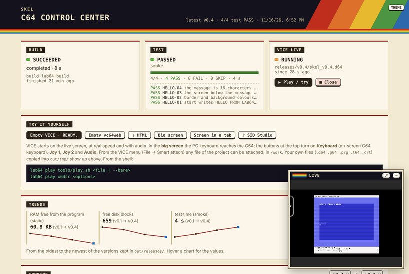

**Try it yourself** has the buttons that do not depend on a version: empty VICE (BASIC `READY.`), empty vc64web, **↓ HTML** (the portable
vc64web page as one file, for example for the phone), the big screen, the live screen in its own tab and **SID Studio**. The files
copied into `out/tmp/` are listed here too, each with its own VICE and vc64web buttons.

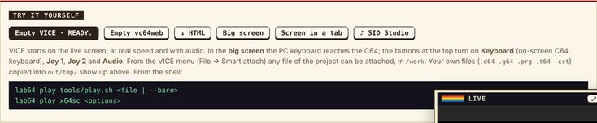

**Trends** draw each measure of the manifest (`metrics`: free RAM, free disk blocks, test time, ...) from the oldest to the newest of the
versions kept in `out/releases/`; hovering a chart shows the values. **Compare** puts two versions side by side: every measure with its
difference, the disk files whose size changed and the tests whose result changed.

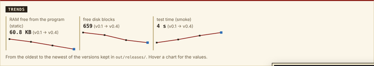

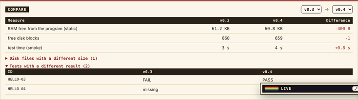

**Versions**: one card per version in `out/releases/`, newest first, with the test result and the measures of the version. The buttons
open the disk in vc64web or in VICE live, download the `.d64` and show the `manifest.json`. The table lists every artifact (disk,
manual PDF, memory map, music, test report) with size, production time and SHA-256; the disk directory and the test list open below.

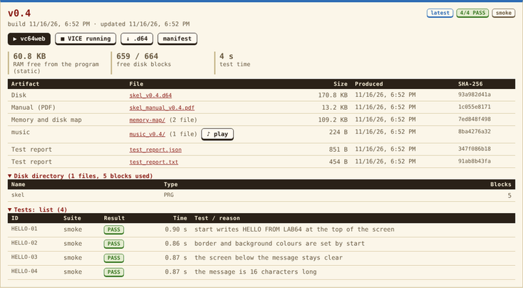

A version with a failing test shows `N FAIL / M` in its header, and the card opens the test, its suite, the time and the reason.

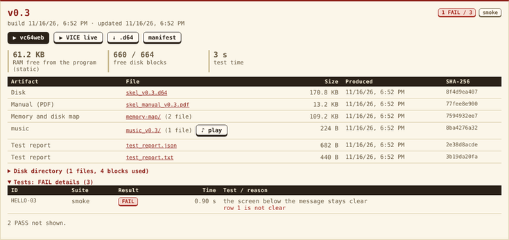

The **dark theme** (the **THEME** button) is the same page with the dark palette.

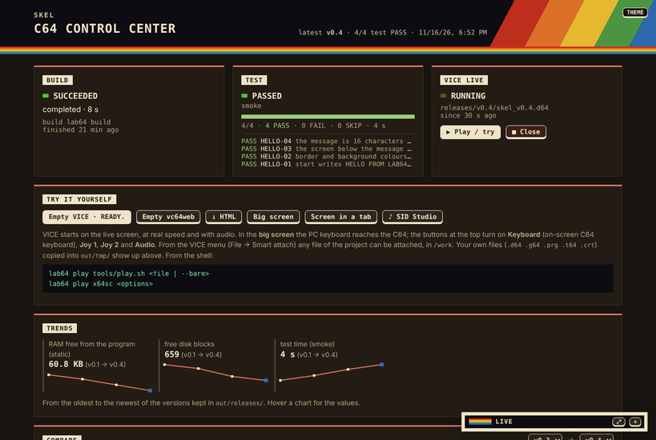

## Live screen

`live.html` (the big screen, or a tab): VICE at real speed on the viewer screen (KasmVNC), with audio from the
**Audio** button (and **Vol**). The PC keyboard reaches the C64.

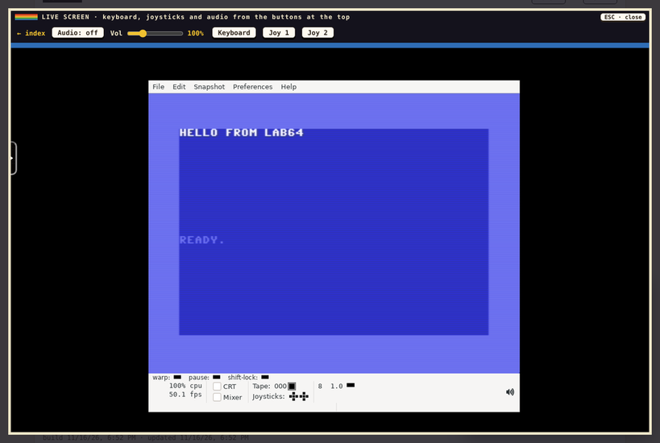

**Keyboard** shows the on-screen C64 keyboard over the screen (every key, with RUN/STOP, RESTORE and the function keys), usable with the
mouse or a finger.

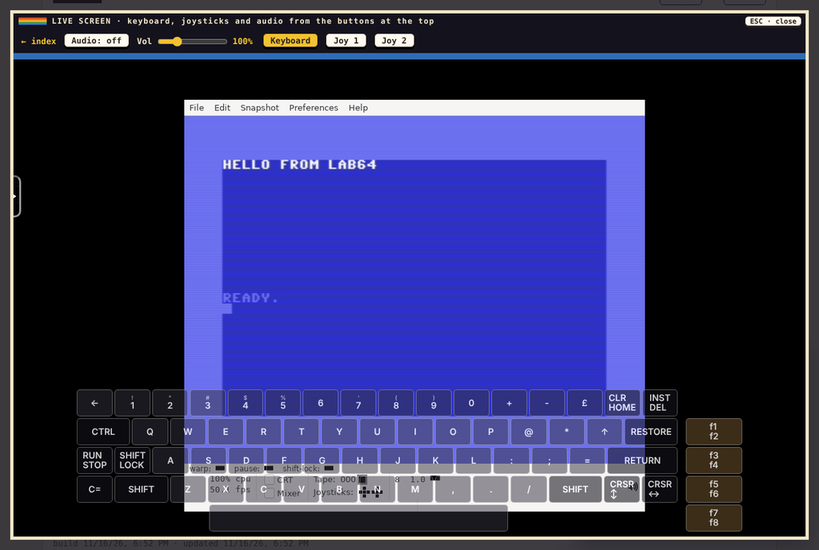

**Joy 1** and **Joy 2** show a joystick and a fire button for port 1 and port 2; they can be combined with the keyboard.
(1.14) **Move** in the header: the keyboard and the joysticks can be dragged, with the right mouse button at any time or with
**Move** on and any pointer; the places stay in the browser, a double click on **Move** puts them back.

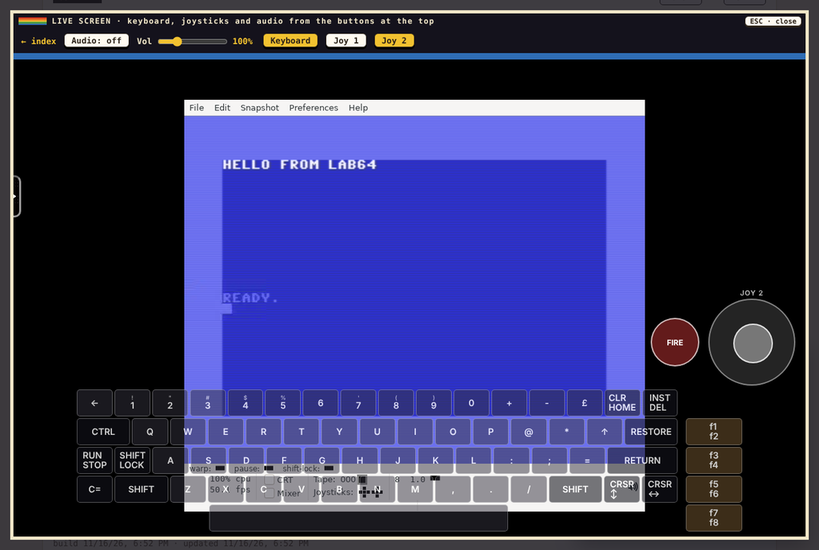

**Zoom (1.11):** the **− 100% +** buttons in the header of `live.html` (steps 100, 125, 150, 175, 200, 250, 300 %, remembered in the browser)
scale the screen: the page gives the iframe 1/z of its space and scales it by z, so the remote screen (`resize=remote`) shrinks and everything on it looks
z times bigger. **Limit:** a window on the screen does not shrink with it, so the zoom is useful only while the screen stays larger than the window (VICE opens
at about 720×644: on a 1280×853 page up to about 125 %). The screen has no window manager, so a window is not resized later (VICE's full screen only hides its
borders); give VICE the size at start (`-windowwidth` / `-windowheight`, the project's own player script).

## vc64web

The **▶ vc64web** button of a version, or **Empty vc64web**: the emulator in the browser with the disk of that version already
loaded and started, with its on-screen keyboard, joystick and fire button, and the track bar of the drive.

(1.13) On a computer (mouse) **FIRE** sits next to the stick, on the right; on a phone (touch) they stay on opposite sides, one per
thumb. RUN/STOP, RETURN and SPACE stay above the track bar of the drive. The stick, FIRE, those three buttons and the keyboard can be
**moved**: drag them with the right mouse button (at any time), or turn on **✥** in the top bar and drag them with any pointer;
the places are remembered in the browser, a double click on **✥** puts them back (landscape layout only).

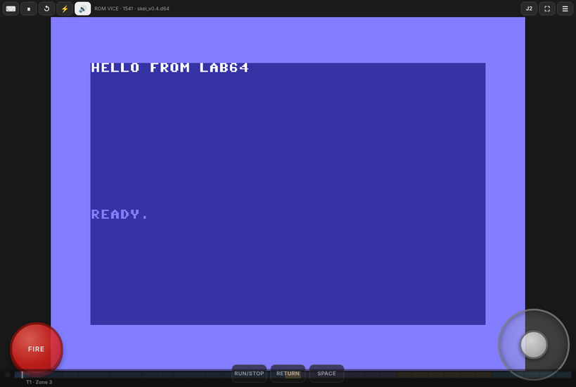

Its menu has the disk and program loading, quick commands (`LOAD "$"`, `LIST`, `LOAD "*",8,1`, `RUN`), autoload, emulator control,
joystick and keyboard, memory (POKE / PEEK) and the ROMs and drive.

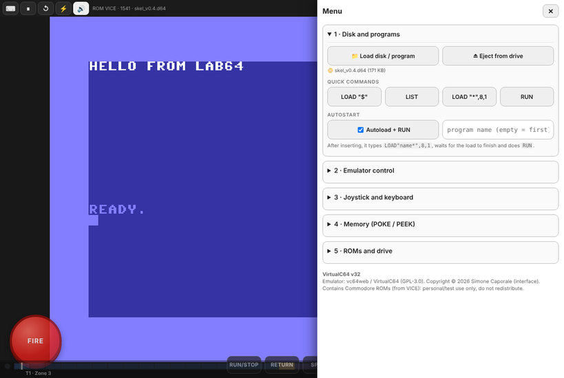

## SID Studio

`sid.html`, **♪ play** on a `.sid` file of a version, or the **♪ SID Studio** button: library, transport with subtunes,
VU meter, spectrum, one panel per voice (scope, envelope, waveform, note, ADSR, routing), master strip, piano roll, automation lanes, SID
filter override, register table, jsSID live or reSID rendered audio, WAV recording and export. The desk can be rearranged (1.13: drag a
panel by its grip **⠿** or its title; dropped in the middle of another panel the two **swap places**, near its left or right edge it goes
before or after it; resizing a panel keeps the page where it is); see
[manifest.md](manifest.md) for the whole description.

How SID Studio plays:
- **Audio source**: **jsSID · live** (default) or **reSID · rendered** (the tune is rendered by `sidplayfp` through the viewer's `/render`).
- **Clock and timing (jsSID)**: the PSID v2+ flags choose PAL (985248 Hz, 19656 cycles per frame = 50.12 Hz) or NTSC (1022727 Hz, 17095
  cycles = 59.83 Hz); a selector next to 6581 / 8580 overrides it. A CIA tune plays at clock / (latch + 1).
- **6581 and mix (jsSID)**: the 6581 output carries the chip's DC offsets (so 4-bit digis through `$D418` are audible; not on the 8580);
  the mix goes through reSID's external filter (low-pass 16 kHz, high-pass 16 Hz) and is clamped to [-1, 1].
- **AudioWorklet**: the sound is computed in an AudioWorklet, which needs a secure context (`http://localhost` or `https`). Over plain `http`
  from a host name of `VIEW_HOSTS` SID Studio uses the ScriptProcessor engine (the top bar shows `jsSID · script`); `&engine=script` in
  the address forces it. `getmem()` of the worklet engine mirrors only `$D400-$D41F`.
- **reSID source**: a second jsSID, silent, runs in an AudioWorklet locked to the rendered WAV, so the registers, envelopes, per-voice
  scopes (badge `jsSID synthesis`: their shape is jsSID's, not reSIDfp's), player CPU, piano roll and automation lanes follow the tune at the
  position being heard. Solo and the SID filter override stay greyed. **A/B** (key B) crossfades (10 ms) between the WAV and that jsSID.
- **Export**: **⇩ WAV** (offline, faster than real time; needs the worklet) and **● REC**.

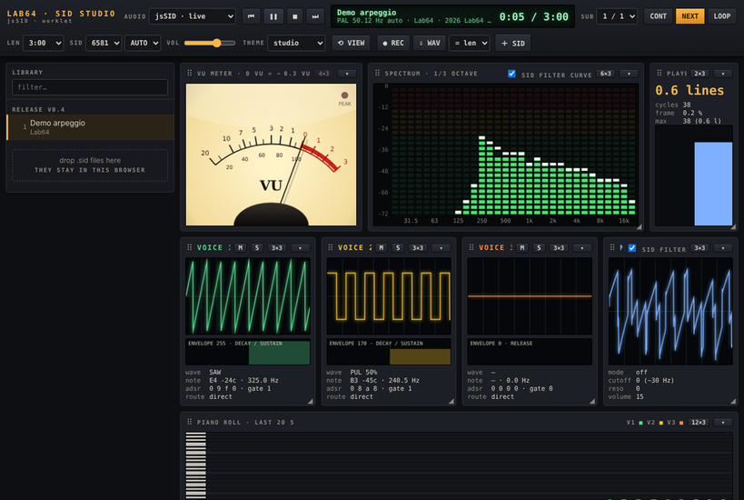

The rendering done by `sidplayfp` is described in [sid-rendering.md](sid-rendering.md).

## Memory map page

`memory-map/index.html` of a version, made by `lab64 map`: summary of the free memory, annotated areas, free memory by
use, the 256-byte page overview, layers by module, the modules, the disk and the limits, all produced automatically from the 64tass listings, the labels and
the disk. See [memory-maps.md](memory-maps.md).

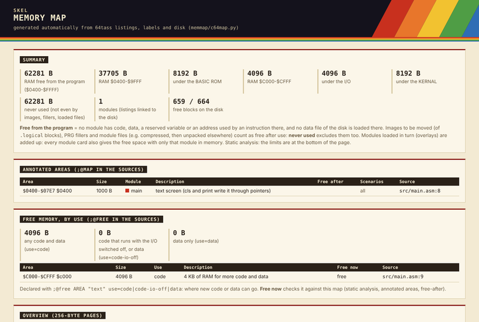

## Render endpoint

`POST /render` of the viewer (SID Studio's reSIDfp source) takes JSON
`{"src": "releases/v1/x.sid" | "sid_b64": "<base64 of a .sid>", "params": {...sidrender parameters}}` and forwards it to the player
daemon, which runs `containers/tools/py/sidrender.py` (one render at a time, 300 s timeout) and answers `{"ok": true, "file": "cache/sidrender/<sha256>.wav",
"seconds", "took", "cached", "params", "tune"}`; the page then fetches `/out/cache/sidrender/<sha256>.wav`. Protections: the same as
`/control` (Host allowlist `VIEW_HOSTS`, same-origin, `application/json` only, password), body at most 160 KB (413), a `.sid` at most 65 KB
+ header; `src` is a `.sid` path relative to `out/` (no `/` at the start, no `..`, no links leaving `out/`); the parameters are checked by
a whitelist / ranges in the server **and again** in the daemon (400 `invalid`, 429 `busy` while another render runs, 500 `failed`, 503
no player, 504 timeout). The daemon has no network and no Docker socket. A user's own `.sid` file (dropped in the page) is **sent to
this local container** to be rendered: the page says so before the first upload; it does not leave the computer.
